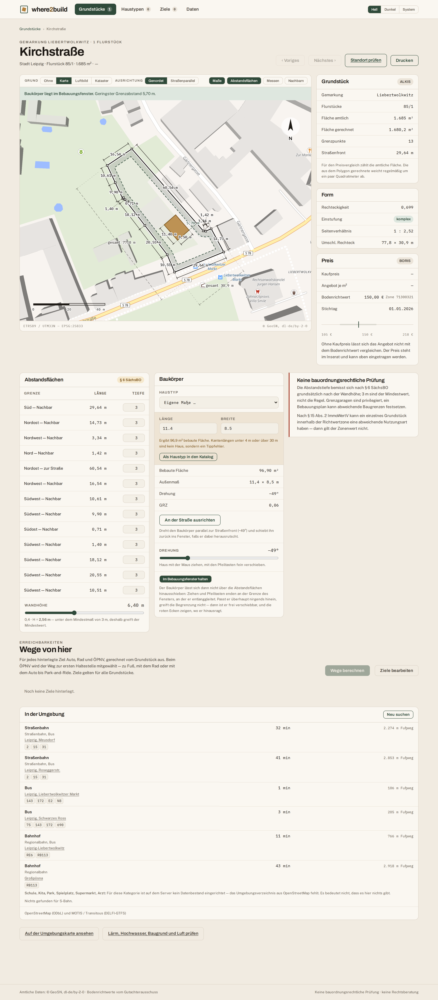

# where2build

Plot appraisal for Saxony. Paste a listing, get the official cadastral parcels
behind it, measure them, hold the asking price against the official land value,
place a prefabricated house inside the setback envelope, and see how long it
takes to get to work, school and the station.

> Interface language is German throughout; source code, comments and this file
> are English. See [`CLAUDE.md`](CLAUDE.md) for the rule and
> [`DESIGN.md`](DESIGN.md) for the visual system.

> **How this was built.** Spec-driven development with Claude. The requirements
> were written first — as a pre-project note and then a clickable mock that was
> reviewed and approved before any application code existed — and the
> implementation was carried out by [Claude](https://claude.ai/code) working
> against that specification, under review at every step. `CLAUDE.md` is the
> working agreement that fell out of it: the decisions that are settled, the
> traps that already cost time, and what has to be true before a change counts
> as done. Statements in this repository about an external service are there
> because a request was made and its answer read, not because a model believed
> them.



## What it does

| | |
|---|---|
| **Take a plot in** | From the search field, from a listing URL, from a pasted page, or straight from *Gemarkung* + parcel numbers. The search reads what was typed before it looks anything up — an address never begins with a digit, a coordinate is two numbers, a parcel denominator cannot occur in an address — and where two readings stay plausible it asks both local indexes rather than guessing. A four-step wizard shows what the model read, where each value came from, and what it could not find. |
| **Resolve the parcels** | ALKIS gives the outline, the official area and the parcel identifier. A plot is a *set* of parcels — the normal case, not the exception — so geometries are unioned and official areas summed. |
| **Judge the shape** | Rectangularity as polygon area over the area of its smallest rotated bounding rectangle, plus street frontage and vertex count. |
| **Judge the price** | €/m² against the BORIS land value for the zone, as a percentage rather than a hunch. |
| **Draw the setbacks** | The strip that may *not* be built on is the part that gets colour. Depth is adjustable **per boundary segment**, because § 6 SächsBO measures from wall height and treats 3 m as a floor. |
| **Place a house** | From the catalogue or from dimensions you type yourself. Drag it, rotate it, or align it to the street front in one click; corners leaving the envelope are flagged. |
| **Check the location** | Noise, flood, radon, drinking-water protection, protected areas, slope, ground and air quality — asked with the *parcel outline*, never with a point, because a plot straddles isophones and zone boundaries. Eleven checks, each a sentence composed from a template, and a counter instead of a score. |
| **Check reachability** | Car, bike, transit and the best combination to each saved destination, via MOTIS. |
| **Compare and print** | Several candidates side by side at one scale. There is no separate print view — the page on screen is the page that prints. |

## Running it

Requires Node 22+ and Python 3.11+.

On Windows, use PowerShell paths and the Python launcher:

```powershell
# Backend — FastAPI, proxy and cache in front of the official services
py -m venv backend\.venv
backend\.venv\Scripts\python -m pip install -e "backend[dev]"
Copy-Item backend\.env.example backend\.env    # then fill in LLM_API_KEY
backend\.venv\Scripts\python -m uvicorn app.main:app --reload --app-dir backend

# Frontend — Vite + Vue 3, Options API
Set-Location frontend
npm install
npm run dev                                    # proxies /api to 127.0.0.1:8000
```

If venv creation was interrupted and `backend\.venv` only contains a partial
environment, remove it first with `Remove-Item -Recurse -Force backend\.venv`.

On Linux and macOS:

```bash
# Backend — FastAPI, proxy and cache in front of the official services
python3 -m venv backend/.venv
backend/.venv/bin/pip install -e "backend[dev]"
cp backend/.env.example backend/.env          # then fill in LLM_API_KEY
backend/.venv/bin/python -m uvicorn app.main:app --reload --app-dir backend

# Frontend — Vite + Vue 3, Options API
cd frontend
npm install
npm run dev                                   # proxies /api to 127.0.0.1:8000
```

Without the backend the frontend still loads, but nothing that needs a service
works: every call throws and the page shows the reason instead of a number.
There is no worked example to fall back to — see *Never show example data*
below. Everything the user enters lives in `localStorage`; **Daten** exports
and imports it as JSON.

## Deploying it

Two containers, no database. The backend is a proxy and a disk cache in front
of the official services; everything a user enters stays in their browser.

```bash
cp backend/.env.example backend/.env    # optional — only LLM_API_KEY matters
docker compose up --build               # then open http://localhost:8080
```

nginx serves the built frontend and proxies `/api` to the backend, so the
browser only ever sees one origin and CORS never enters into it. The backend
is not published on the host; reach it through `/api`, or add a `ports:` entry
if you want it separately.

| | |
|---|---|
| **Port** | `WHERE2BUILD_PORT=9000 docker compose up` to serve somewhere other than 8080. |
| **Cache** | The named volume `backend-cache` holds what the official services answered. Losing it costs time and their bandwidth, not correctness. |
| **POI directory** | `backend/data` is mounted read-only. Build the index with `python backend/scripts/build_poi_index.py --download` and `/api/nearby` will use it; without it that endpoint says so for the OpenStreetMap categories instead of answering with an empty list. The default extract is all of Saxony; `--url` and `--out` take any other region — see [Reach of the POI index](#reach-of-the-poi-index). |
| **Extraction** | Without `LLM_API_KEY` in `backend/.env`, reading a listing page stays switched off. Everything else works. |
| **Contact address** | Set `APP_CONTACT` before any real use: the Transitous usage policy requires one. |
| **Own router** | `docker compose --profile local-routing up` runs MOTIS here instead of asking Transitous. See below. |

`backend/.env` is read if it exists and skipped if it does not, so the stack
comes up either way.

### Recurring jobs

```bash
docker compose --profile scheduled-jobs up -d
docker compose exec scheduler python scripts/run_jobs.py list
docker compose exec scheduler python scripts/run_jobs.py run cache-sweep
```

The jobs live in [`ops/jobs.json`](ops/jobs.json) — adding the next one is a
new entry there, not new code. `list` prints each job's schedule, the reason it
exists and when it last ran with what exit code. Nothing retries on its own: a
failed import that retried would hide a genuinely broken feed behind three more
failures, and the next scheduled run is the retry.

The scheduler runs from the backend image and touches only the shared volumes,
so it needs no Docker socket — mounting that would hand a container root on the
host for the sake of a few timed commands. Rebuilding an index writes into
`backend/data`, and the API reads its indexes at startup, so the backend has to
be restarted afterwards for a new one to take effect.

**The MOTIS refresh is deliberately not one of these jobs.** It stops a service
and replaces a volume, which is a host-side operation, so it stays a host cron
entry:

```cron
40 2 * * 1  cd /srv/where2build && ./motis/fetch-data.sh && docker compose --profile local-routing up -d --force-recreate motis-import motis
```

### Routing on your own machine

Routing goes to [Transitous](https://api.transitous.org) by default. That is a
volunteer service: its policy asks to be contacted before "many requests",
counts routing itself as resource-intensive, and rules out commercial use
(`docs/research/routing-motis.md` § 6). Anything past a prototype should bring
its own router, and the `local-routing` profile is that router.

```bash
./motis/fetch-data.sh                                   # ~420 MB of input data
MOTIS_BASE_URL=http://motis:8080 \
  docker compose --profile local-routing up --build     # first start imports
```

Without the profile nothing changes: `docker compose up` is still two
containers and still talks to Transitous.

| | |
|---|---|
| **Data** | An OSM extract (Saxony from Geofabrik, ODbL, © OpenStreetMap contributors) and the Germany-wide DELFI GTFS (349 MB, CC-BY 4.0, DELFI e. V.), taken from Transitous' own republished copy so no opendata-oepnv.de account is needed. Attribute both wherever routes are shown. |
| **Import** | Once, into the `motis-graph` volume: **6 min** and **5.6 GiB peak RSS** for Germany's timetable on a 4-core machine, giving a **3.4 GB** graph. Re-runs are skipped; delete the volume to rebuild. |
| **Serving** | The graph is memory-mapped, so the server is ready seconds after start and holds **1.7 GiB**. |
| **Same answers?** | Yes. Geocoding, `/plan`, `one-to-many` and `map/stops` agree with Transitous to the last decimal, and `/api/reachability` comes back character for character identical, route geometry included. Measured 01.09.2026, `docs/research/routing-motis.md` § 5.6. |
| **Switching back** | The backend's disk cache is keyed on the request, not on which MOTIS answered it. After changing `MOTIS_BASE_URL`, clear `/cache/motis*` or you keep reading the old service's answers. |
| **Currency** | DELFI publishes weekly, on Mondays. Re-run `fetch-data.sh`, `docker compose down`, `docker volume rm where2build_motis-graph`, and start again. |

### Reach of the POI index

`/api/nearby` answers the six OpenStreetMap categories — school, kindergarten,
park, playground, supermarket, doctor — from a file the backend builds from an
OSM extract. Stops and stations do not come from that file; they come from the
timetable, which covers Germany either way.

**Saxony is the scope, and it is the minimum.** Nothing in the code knows about
Saxony: `build_poi_index.py` names an extract and an output path as defaults
and takes `--url` and `--out` for anything else, and the API reads whichever
file `NEARBY_POI_INDEX_PATH` points at. Another Land, all of Germany or a
single city is a different extract, not a code change.

What it costs, measured on the built index rather than estimated: **5 682
entries, 718 kB on disk, 66 ms to load, 2,2 MB resident** — about 126 bytes per
entry stored and 390 in memory. Query time does not grow with the index; the
grid only touches the buckets near the point. Projected forward, all of Saxony
(22 622 features, counted from taginfo) is ~2,8 MB and ~9 MB resident; Germany
lands near 70 MB and ~220 MB, which is where the file should become SQLite —
one process holds it comfortably, several worker processes multiply it.

One caveat that is invisible from outside: **the index carries the extract it
was built from in `quelle`, and the filename is only a default.** An index
built from a city box is still called `poi-sachsen.json`. Read the metadata,
not the name.

Two things degrade outside Saxony, and neither produces a wrong answer: the
school-type classifier reads German school names (`Oberschule` is Saxon;
Bavaria says `Mittelschule`) and simply derives no type elsewhere, and the tag
exclusions were justified on Saxon counts. Details in
[`docs/research/poi.md`](docs/research/poi.md) § 12.

## Tests

```bash
backend/.venv/bin/python -m pytest backend/tests -q   # 385 passed, 1 skipped
cd frontend && npm run test                           # 350 passed, 10 skipped
cd frontend && npm run test:integration               # the 10, against a running backend
node scripts/screenshots.mjs                          # 41 images and a print PDF
```

The backend suite touches no network: ALKIS, BORIS, MOTIS, OpenFreeMap and the
model are stubbed with `respx` against fixtures whose shapes come from the
research in [`docs/research/`](docs/research/).

The frontend suite mounts the real components against **recorded real service
responses** in `frontend/tests/fixtures/`: two parcels (one convex, one
markedly concave), the ELK house-type sheet, and a MOTIS answer for
Liebertwolkwitz → Leipzig Hbf and → the local primary school. Nothing in a
test is a number someone chose to make an assertion pass. `test:integration`
is the same questions asked of a backend that is actually running.

`scripts/screenshots.mjs` writes to `docs/screenshots/`. It builds its state
through the real add flow — ALKIS, Liebertwolkwitz 85/1 — and fails on a
console error, on horizontal overflow, and if not a single vector tile
arrived. Look at the images: tests do not catch a collapsed layout.

## Layout

```
backend/          FastAPI. Proxy, cache and schema validation. Owns no geometry.
  app/services/   alkis, boris, llm, motis, tiles
  app/routers/    one per endpoint group
frontend/
  src/lib/        geometry, projection, routes, store, api, formatting
  src/components/ SitePlan (the drawing), PlotCard, RouteCards
  src/views/      Plots, Plot, Wizard, Compare, HouseTypes, Destinations, Data
  src/styles/     tokens, base, print
docs/             Spec, service research, screenshots
mockup/           The approved UI mock. Reference, not built.
```

**All geometry runs in the browser.** Buffering, rotation and collision happen
while the user drags, with no round trip; the binding numbers come from ALKIS
anyway. The backend owns network access, caching and schema validation, and
nothing else.

## Endpoints

| Method | Path | |
|---|---|---|
| `POST` | `/api/parcels/resolve` | address, coordinate (WGS84 or ETRS89/UTM33N as the Geoportal prints it) or *Gemarkung* + numerator/denominator → GeoJSON in EPSG:4326 with the official area |
| `POST` | `/api/parcels/nearby` | one coordinate → the parcels around it, the one covering it first, then by distance — an address coordinate sits on the building the register recorded, and a few metres either way is the neighbour's parcel |
| `POST` | `/api/listings/extract` | `{url}` or `{text}` → listing fields, each with its source |
| `POST` | `/api/housetypes/extract` | `{url}` → house type, fetch restricted to the manufacturer's domain |
| `GET` | `/api/landvalue` | `?lat=&lon=` → €/m², zone, reference date, and the size of the notional plot the value is quoted for |
| `POST` | `/api/site-checks` | one parcel outline → noise bands, flood, radon, water protection, protected areas, slope, ground and air quality; each check carries either data or its own German `fehler` |
| `POST` | `/api/reachability` | origin + destinations + modes → durations and route geometry |
| `GET` | `/api/tiles/{layer}/{z}/{x}/{y}.png` | cached proxy for the GeoSN WMS layers (`dop`, `webatlas`, `alkis` — parcel boundaries with their numbers, and the buildings) and, through the ArcGIS `export` endpoint, the noise survey (`laerm`, `laerm-nacht`) |
| `POST` | `/api/nearby` | one coordinate → the nearest school, park, tram stop and so on, ranked by walking time; `linien: true` also names the lines calling at each stop |
| `GET` | `/api/gemarkungen` | `?q=` → the Saxon cadastral districts, served from a committed index; the WFS is never touched |
| `POST` | `/api/geocode` | `{text, lat?, lon?}` → candidates, never one answer: the same street name matches in three states |
| `POST` | `/api/neighbours` | one outline → the neighbouring buildings, for showing where a setback area would reach onto the plot |
| `GET` | `/api/basemap/style.json`, `/api/basemap/{path}` | the vector basemap, rewritten so MapLibre never reaches the internet itself |
| `GET` | `/api/health` | which services are configured |

## Configuration

`backend/.env`, all optional except the model key:

```
LLM_BASE_URL=https://openrouter.ai/api/v1
LLM_API_KEY=sk-or-v1-...
LLM_MODEL=anthropic/claude-sonnet-4.6
LLM_FETCH_ENGINE=openrouter        # openrouter | exa | parallel | native
APP_USER_AGENT=where2build/0.1 (contact@example.org)
```

No provider is wired in. The client is OpenAI-compatible, so switching is a
change to `LLM_BASE_URL` and nothing else. `APP_USER_AGENT` must carry a real
contact address before any real use of Transitous.

The basemap follows the interface: `BASEMAP_STYLE_PATH` (default
`styles/liberty`) is the light map, `BASEMAP_DARK_STYLE_PATH` (default
`styles/dark`) the dark one, and the browser asks for the variant that matches
the resolved theme. Clearing the dark path serves the light style to everyone.

## Things that already cost time

Each of these is verified, not assumed — the details are in
[`docs/research/`](docs/research/).

- **`response_format: json_schema, strict: true` is not honoured while
  `tools: [web_fetch]` is active in the same call.** Reproduced across three
  models. Extraction is therefore two calls: fetch, then structure.
- **MOTIS is `/api/v6/plan`**, not `v1`, and `legGeometry` uses **precision 6**.
  Decoding at precision 5 puts the route a factor of ten away.
- **BORIS `INFO_FORMAT=application/json` returns UTFGrid**, not GeoJSON, and
  fails outright on the combined layer. Use `text/plain` or GML.
- **immobilienscout24.de answers server-side fetches with 401** on every route
  tested, so its adapter goes straight to the paste field.
- **kleinanzeigen.de carries `og:latitude`/`og:longitude`** in its meta tags —
  parse those and skip both the geocoder and the model call.
- **ALKIS stored queries need the `CRS` parameter**; without it the service
  answers HTTP 400 with a generic HTML page rather than an OGC error. Ad-hoc
  `fes:Filter` expressions need the `ave:` namespace prefix.
- **Use the official area** for anything price-related. The area computed from
  the polygon differs by a few square metres; both are shown side by side.
- **MapLibre's worker must be pointed at explicitly.** It resolves
  `./maplibre-gl-worker.mjs` next to its own module, which after bundling is
  the app chunk — a file the bundler never emits. The request 404s, vector
  tiles are never parsed, and the map stays blank **without one error
  anywhere**, while raster layers keep working. `frontend/src/main.js` imports
  the worker with `?worker&url` and calls `setWorkerUrl`.
- **MapLibre rejects a relative `sprite` URL** while accepting relative glyph
  and tile URLs, and it does not resolve the relative `tiles[]` inside a
  TileJSON against the source URL. The proxy answers relative — only the
  browser knows which origin it reached the API on — and the frontend expands
  them and inlines the TileJSON.
- **Never show example data.** There is no sample state and no fallback. A
  derived figure whose input is missing stays a dash; computing it anyway is
  where "0,00 €" and "−100 % under the land value" came from.

## Not done yet

- **No persistence on the server.** Plots live in the browser, and PostGIS is
  still in the plan rather than the code. Addresses no longer wait on it: the
  Hauskoordinaten import landed, so `/api/geocode` answers from the official
  register and only falls back to the MOTIS geocoder for what the register does
  not hold. A spatial join between addresses and parcels is what PostGIS is
  still wanted for.
- **Boundary labels crowd on parcels with many short sides.** Every segment is
  labelled up to sixteen of them, and adjacent near-parallel sides can overlap;
  the overall size stays readable. Real label placement, rather than offset
  rings, is what would fix it —
  [the design for that is written down](docs/lageplan-beschriftung.md),
  including why it is not being built yet.
- **The dimension figures get small on a narrow screen.** Nothing overflows, but
  at 390 px they are hard to read.
- **Three location checks have no source.** Heavy rain (KOSTRA-2020) exists as a
  DWD raster to download rather than a service and needs an import; Saxony
  publishes no state-wide contaminated-sites data at all; and the federal mobile
  and broadband portals have no open interface. All three are shown as open
  with the reason rather than left out, because a list that silently omits what
  it cannot answer reads as a complete one.

## Attribution

Official data © Staatsbetrieb Geobasisinformation und Vermessung Sachsen
(GeoSN), [Datenlizenz Deutschland – Namensnennung 2.0](https://www.govdata.de/dl-de/by-2-0).
Land values from the responsible *Gutachterausschuss*. Timetable data from
DELFI via [opendata-oepnv.de](https://www.opendata-oepnv.de/), road network
from OpenStreetMap contributors.

**This is not a building-law assessment and not legal advice.** Setback depth
under § 6 SächsBO follows wall height, party-wall garages are privileged, and a
development plan can set different building lines. Under § 15 (2) ImmoWertV an
individual plot inside a land-value zone may have a different permitted use, in
which case the zone value does not apply to it.
